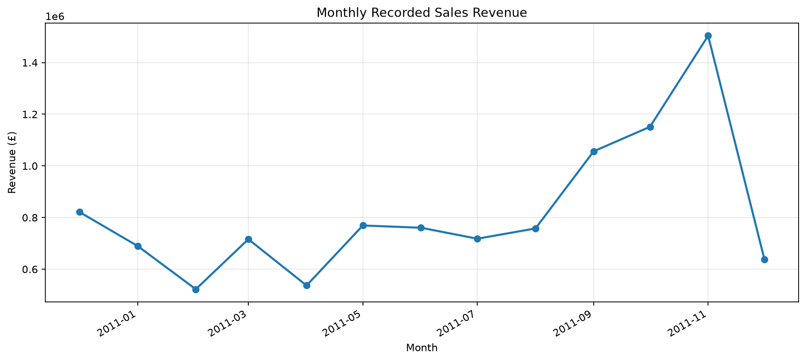
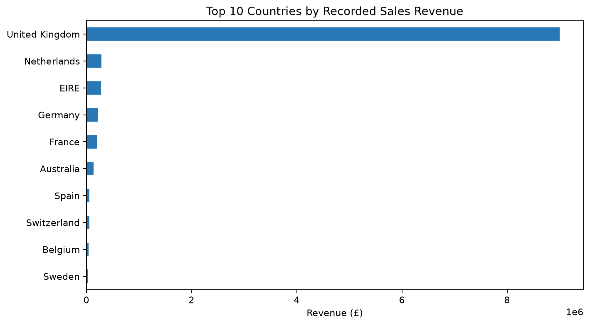
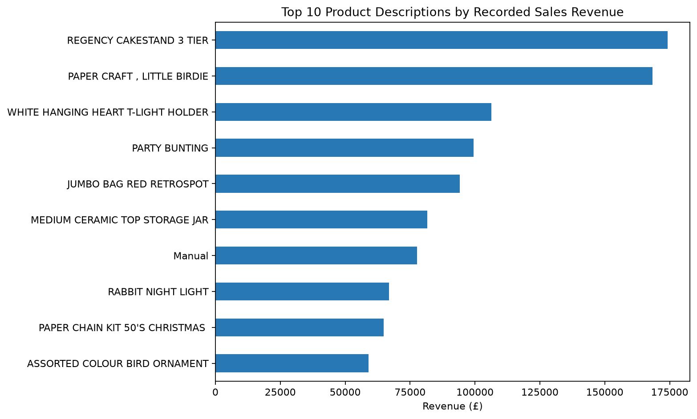

# Online Retail Sales Analysis

Exploratory analysis of the UCI Online Retail dataset, focused on sales revenue trends, country and product contribution, and repeat purchasing.

## Key results

- **524,878** positive sales rows after removing exact duplicate rows and excluding returns/cancellations and zero-price rows.
- **£10,642,110.80** recorded sales revenue (quantity × unit price).
- **£1,503,866.78** in November 2011, the highest complete month in the period. December 2011 is partial (data ends 9 December).
- The United Kingdom represents approximately **84.6%** of sales-only revenue.
- **65.6%** of customers with an ID made purchases on more than one distinct invoice in this sales-only view.

These are descriptive transaction totals, not audited accounting revenue or causal findings. See the notebook for definitions, recommendations, charts, and caveats.

## Project layout

```text
data/
  raw/                 # Downloaded source workbook (not committed)
  processed/           # Optional generated data (not committed)
notebooks/
  01_retail_sales_eda.ipynb
reports/
  charts/              # Generated notebook figures
  monthly_revenue_summary.csv
```

## Charts







The [monthly revenue summary](reports/monthly_revenue_summary.csv) includes sales revenue, unique invoices, and month-to-month revenue change.

## Run the analysis

1. Install Python 3.10+ and create/activate a virtual environment.
2. Install dependencies: `python -m pip install -r requirements.txt`
3. Download the **Online Retail** workbook from the [UCI Machine Learning Repository](https://archive.ics.uci.edu/dataset/352/online+retail) and place it at `data/raw/Online Retail.xlsx`.
4. Start Jupyter from the project root: `jupyter notebook notebooks/01_retail_sales_eda.ipynb`
5. Run all cells. The charts are saved under `reports/charts/`.

The raw workbook and generated processed data are excluded from Git; this keeps the repository lighter and makes the source and reproduction steps explicit.

## Dependencies

See [`requirements.txt`](requirements.txt).
